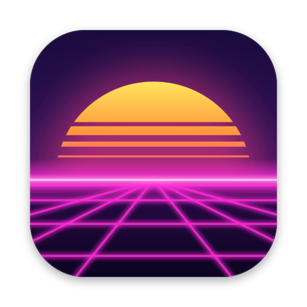

<p align="center">
  
</p>

<h1 align="center">Solara</h1>

<p align="center">A Mac browser with Arc's sidebar and Dia's polish, on Chromium built from source.</p>

Solara is a macOS browser from Hill Technologies. Every window and tab is Chrome's own, from an engine we build
ourselves, so sites, extensions and DevTools behave the way they do in Chrome. Around it sits a native shell that
copies Dia's look and behavior, measured against Dia, with Arc's sidebar for tabs.

- **No account.** Nothing to sign up for. Sync, if you turn it on, goes through a folder in your own iCloud Drive,
  end-to-end encrypted.
- **No AI features.** On purpose.
- **No telemetry.** Solara sends no usage data and no crash reports. Google's background services are compiled out
  of the engine, and uBlock Origin is built in.
- **Chrome extensions** install from the Chrome Web Store.
- **Moves in for you:** bookmarks, history, passwords, cookies and tabs from Chrome, Safari, Firefox, Arc, Dia and
  more.

It needs macOS 14 Sonoma or later on Apple Silicon.

## Solara and Ardia

Solara is a fork of [Ardia](https://github.com/mantrakp04/ardia) by Mantra Patel, which did the hard part: the engine
build, the shell and most of the features. Solara has its own name, icon, signing and update feed, drops Ardia's site,
telemetry and project tooling, and keeps going its own way while merging Ardia's changes now and then. Thanks to
everyone who built Ardia.

## Getting it

No release is published yet. Once there is one, the DMG will be on
[this repo's releases](https://github.com/andrewbenson/solara/releases), and Solara will update itself from there with
[Sparkle](https://sparkle-project.org): it checks the appcast on the latest release, installs updates quietly, and
shows what changed. Settings › General picks the channel: Stable, or Nightly for prereleases with fixes as soon as
they land.

## Building from source

You need an Apple Silicon Mac with Xcode, CocoaPods, Node 22 and pnpm 11.

```sh
pnpm install
pnpm pods
pnpm dev      # Metro, leave it running
pnpm macos    # builds the Debug app and opens it on its own data folder
```

The app links a Chromium framework. With a Chromium tree at `~/chromium-build`, the build uses the framework you built
there; [docs/engine-build.md](docs/engine-build.md) covers building it (a first build takes about five hours).
Without one, it falls back to a prebuilt engine from upstream Ardia's releases
(`packages/ardiacore/scripts/fetch-engine.sh`), which only exists while `engine/` matches a tree Ardia published, so
plan on building the engine yourself. Releases are built, signed and notarized by `scripts/release.sh`
([docs/releasing.md](docs/releasing.md)).

[CONTRIBUTING.md](CONTRIBUTING.md) explains how changes are made, and [docs/agent-brief.md](docs/agent-brief.md) how
the pieces fit together.

## License

Solara as distributed, the app together with its engine, is licensed under the
[GNU General Public License v3](LICENSE), because the engine is built with Helium's patches, which are GPL-3.0. Its
own source files, Ardia's and Solara's, are under the [Apache License 2.0](LICENSE.Apache-2.0). It also builds on
Chromium (BSD-3-Clause and others), ungoogled-chromium and a few Chromium Embedded Framework patches (BSD-3-Clause),
and bundles uBlock Origin (GPL-3.0) and Sparkle (MIT), each under its own license. [NOTICE](NOTICE) has the full list
and where each release's corresponding source is.
